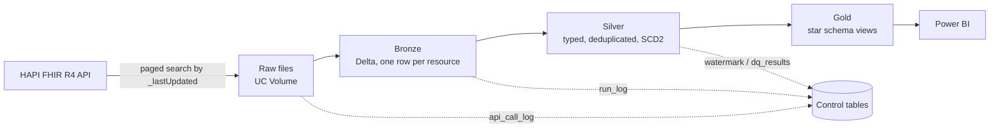

# Architecture

## Flow

Resources run in a fixed order: Patient → Encounter → Observation → Condition, then Gold and the quality checks.

## Layers

| Layer | Location | Content |
|---|---|---|
| Raw | `/Volumes/workspace/fhir_landing/files/raw/<Resource>/load_date=YYYY-MM-DD/` | Each API page saved as returned (`.json` or `.xml`), named `{run_id}_{window_date}_page_{n}` |
| Bronze | `workspace.fhir_bronze.bronze_<resource>` | One row per bundle entry: raw resource JSON/XML, `resource_id`, `version_id`, `last_updated`, `extraction_timestamp` (API call time), `raw_saved_at` (file save time), `api_url_or_params`, request params, source file and page |
| Silver | `workspace.fhir_silver.<resource>` | Flattened typed columns from `conf/silver_columns.yaml`, cleaned, deduplicated per version, SCD2 history |
| Gold | `workspace.fhir_gold.*` | Dimension, fact and aggregate views over current Silver rows |
| Control | `workspace.fhir_control.*` | `api_call_log`, `pipeline_run_log`, `ingestion_watermark`, `dq_results` |

## Incremental loading

- Each run covers the last `ingestion.lookback_days` (default 3) as UTC day windows ending before `run_date`.
- Per resource, the watermark stores the end of the last completed window, so later runs only fetch newer windows; a partial day resumes from the watermark.
- Pages are followed through the bundle `next` link. If a window reaches `api.max_pages_per_window`, the next request restarts at the last `lastUpdated` seen, so large days are fully loaded. If one timestamp alone exceeds the cap the task fails instead of skipping data.
- Bronze only reads files that are in `api_call_log` and not yet in the Bronze table.
- Silver only reads Bronze rows loaded after its latest `source_loaded_at`.

## Versioning (SCD2)

- `row_hash` is a SHA-256 of all mapped attributes.
- A new version is written only when the hash changes; replays and older versions are ignored.
- Several versions arriving in one batch are applied in order.
- Columns: `sk`, `effective_from`, `effective_to` (`9999-12-31` while open), `is_current`.
- Closing and inserting happen in one Delta `MERGE`.

## Data quality

`notebooks/05_quality` runs the checks in `quality.py` and appends results to `dq_results`.

| Check | Severity |
|---|---|
| Bronze lineage columns present | error |
| Silver key and version not null | error |
| One current row per resource | error |
| `effective_to >= effective_from` | error |
| Patient gender in allowed values | warn |
| Facts with unknown patient below `max_unknown_patient_ratio` | warn |
| Watermark newer than `freshness_days` | warn |

Failed `error` checks fail the job when `quality.fail_on_error` is true.

## XML

Set `api.format: xml` to request `application/fhir+xml`. Raw files are stored as `.xml`, and Bronze splits the bundle into one row per resource with `resource_xml` and the same metadata columns (`source_format = 'xml'`). Silver mappings use JSON paths, so Silver reads JSON rows.

## Configuration

Everything environment specific lives in `conf/pipeline.yaml`: API settings, lookback, resources, storage path, catalog and schema names, table names, SCD2 columns, Gold settings and quality thresholds. `pipeline.<env>.yaml` next to it is merged on top when `FHIR_PIPELINE_ENV` (or `project.environment`) matches. Silver column mappings are in `conf/silver_columns.yaml`.
