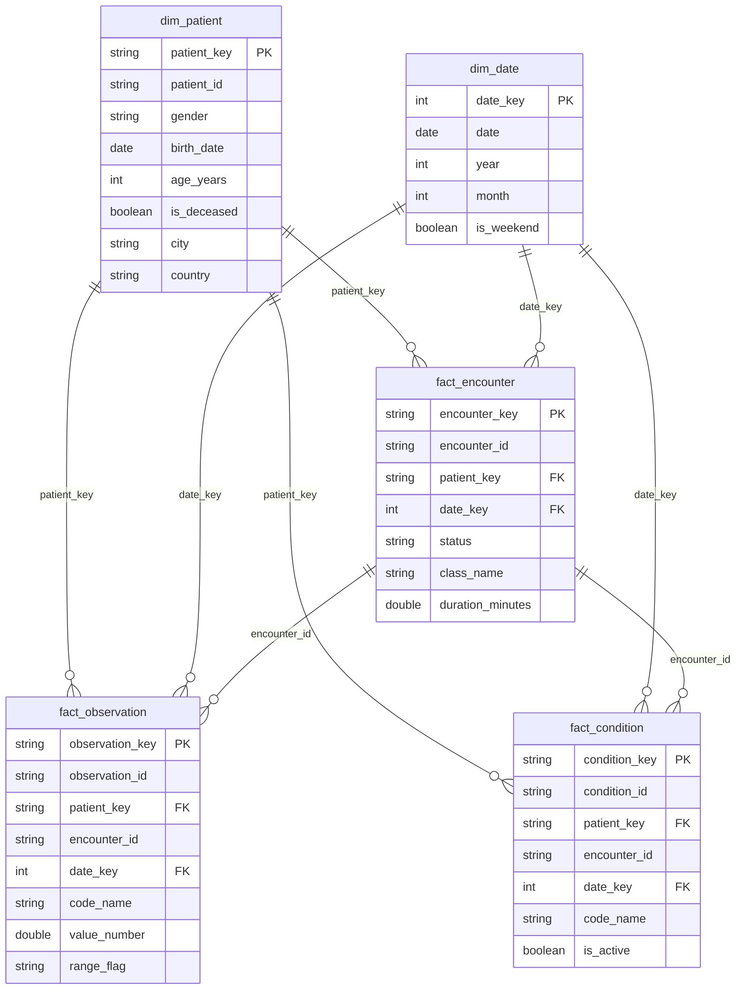

# Data Model

## Gold star schema

## Views

| View | Grain | Notes |
|---|---|---|
| `dim_patient` | current patient | includes an unknown member (`patient_key = '-1'`); phone numbers are not exposed |
| `dim_patient_history` | patient version | all SCD2 versions with validity dates |
| `dim_date` | day | continuous range over the fact dates, limited to `gold.date_start` … today + `gold.date_future_days` |
| `fact_encounter` | encounter | duration in minutes, date of `period.start` |
| `fact_observation` | observation | numeric value, unit, `range_flag` (low / normal / high) from reference range |
| `fact_condition` | condition | `is_active` from clinical status, date of onset or recorded date |
| `agg_daily_activity` | day | encounters, patients seen, average encounter length |
| `agg_condition_prevalence` | condition code | patients, conditions, active conditions, average age |

Facts whose patient is not in the loaded data point to the unknown member so they are not lost in joins.

All fact views and the patient dimensions carry `extraction_timestamp` and `api_url_or_params` from the source row.

## Silver columns

| Table | Columns |
|---|---|
| `patient` | active, gender, birth_date, deceased, deceased_at, family_name, given_name, phone, city, state, postal_code, country, marital_status, language |
| `encounter` | status, class_code, class_display, type_code, type_display, patient_id, practitioner_id, service_provider_id, reason_code, reason_text, period_start, period_end |
| `observation` | status, category_code, code_system, code, code_display, code_text, patient_id, encounter_id, effective_at, issued_at, value_number, value_unit, value_text, value_string, interpretation_code, ref_low, ref_high |
| `condition` | clinical_status, verification_status, category_code, code_system, code, code_display, code_text, severity, patient_id, encounter_id, onset_at, abatement_at, recorded_at |

Every Silver table also has `resource_id`, `version_id`, `last_updated`, `extraction_timestamp`, `api_url_or_params`, `raw_saved_at`, `source_run_id`, `source_loaded_at`, `row_hash`, `sk`, `effective_from`, `effective_to`, `is_current`, `silver_updated_at`.

Cleaning rules: strings are trimmed and blanks become null, codes such as gender and status are lower-cased, references like `Patient/123` keep only the id, and invalid dates or numbers become null instead of failing the load.
